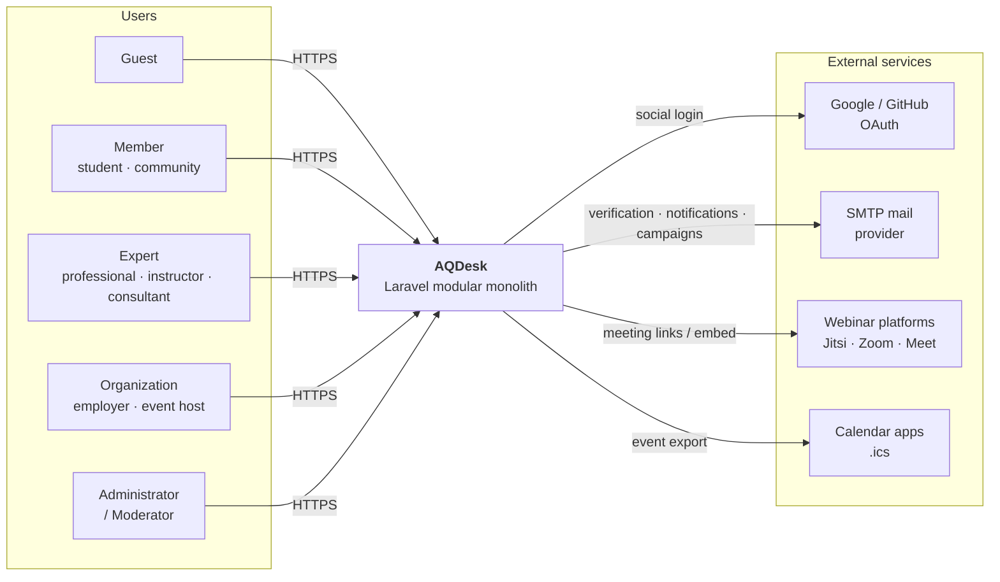
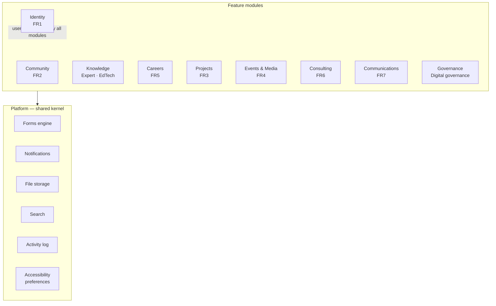
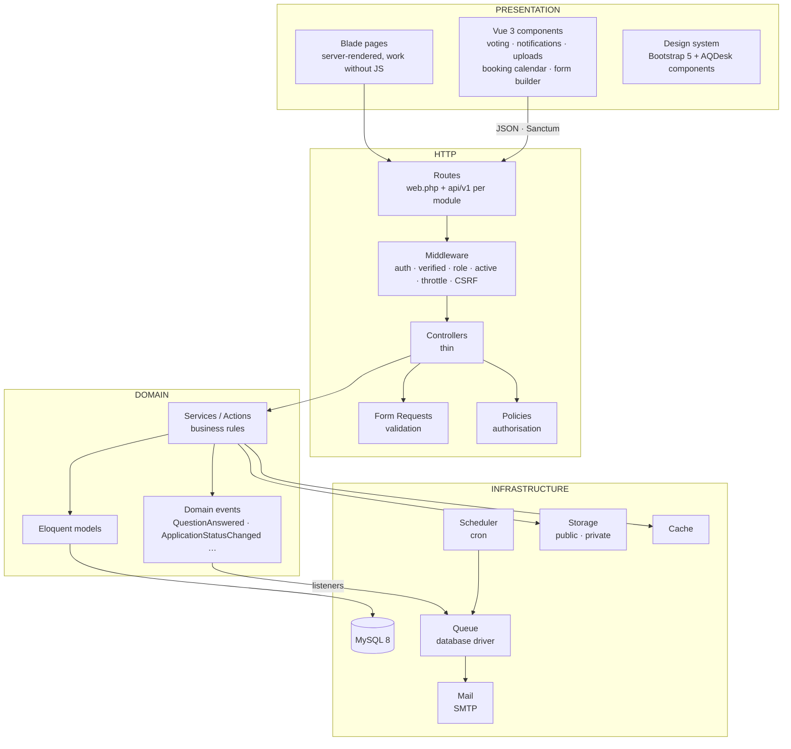
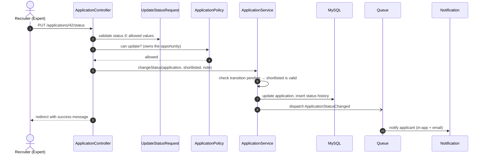
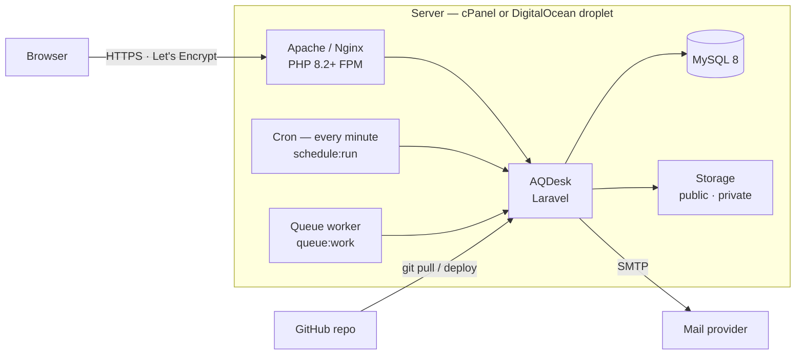

# AQDesk — Software Architecture Document

| | |
|---|---|
| **Project** | AQDesk — "Answer Question" Community, Learning and Knowledge Platform |
| **Course** | CS619 Final Year Project, Spring 2026 |
| **Supervisor** | Mr. Abdullah Qamar |
| **Document status** | Draft for supervisor review (Roadmap step 0.2) |
| **Version** | 1.0 — 2026-10-25 |

---

## 1. Purpose and scope

This document defines the target architecture for the final AQDesk system. It
takes the prototype, which implemented six mandatory modules, to the full scope
of the FYP Requirement File (FR1–FR7) and the Prototype Assignment's project
vision.

The FYP note asks students to consult the supervisor before finalising system
architecture. Section 12 lists the decisions that need approval.

### 1.1 Requirement sources

| Source | What it contributes |
|---|---|
| FYP Requirement File | FR1 User Management · FR2 Community Q&A · FR3 Project Collaboration · FR4 Events & Podcasts · FR5 Jobs & Opportunities · FR6 Consulting · FR7 Newsletter & Announcements · accessibility focus · deliverables |
| FYP closing note | Integration of **education technology**, **community knowledge systems** and **digital governance** concepts |
| Prototype Assignment — Vision | Adds **Expert knowledge sharing** and **Professional opportunities** as distinct services; requires a **modular** design that allows future expansion |
| FYP Deliverables | User Manual for **form creators and respondents**; WCAG testing report; demo of **accessibility features in action** |

---

## 2. Current state (prototype baseline)

| Area | Implemented |
|---|---|
| Stack | Laravel 12, PHP 8.2+, MySQL 8, Blade, Bootstrap 5 (CDN), no build step |
| Structure | Single flat Laravel app: 11 controllers, 10 models, 11 migrations, 32 views |
| Modules | Authentication (email), Role-based access (3 roles), Dashboard, Profile, Community Q&A, Jobs & Internships, Admin moderation |
| Access control | `role:` route middleware + inline ownership checks in controllers |
| Tests | 81 feature tests, in-memory SQLite |
| Not yet built | FR3, FR4, FR6, FR7, social login, email verification, notifications, file privacy, expert knowledge sharing, governance, form builder |

**Gaps the architecture must close:** business logic sits in controllers,
authorisation is scattered, there is no module boundary, no asynchronous
processing, no notification channel, and uploaded CVs are stored on the public
disk.

---

## 3. Architectural drivers

### 3.1 Quality attributes

| Attribute | Target | How the architecture addresses it |
|---|---|---|
| **Modularity** | A new service can be added without editing existing modules | Modular monolith; one folder + service provider per module; modules communicate through events and service interfaces |
| **Accessibility** | WCAG 2.1 AA on every page | Server-rendered HTML first, JavaScript as enhancement; shared accessible component library; per-user accessibility preferences |
| **Security** | No unauthorised read or write of another user's data | Roles → permissions → policies; private file storage with signed URLs; audit log; rate limiting |
| **Maintainability** | Thin controllers, single place for each rule | Layered module structure: Request → Policy → Service → Model |
| **Scalability** | Grow from shared hosting to a VPS without a rewrite | Stateless web tier, queue for slow work, cache layer, indexed queries |
| **Testability** | Every module covered by feature tests | Services are plain classes; tests use in-memory SQLite |

### 3.2 Constraints

- **Stack** preferred by the FYP: PHP/Laravel, Vue.js/Bootstrap, MySQL, Git/GitHub.
- **Hosting** must work on cPanel shared hosting as well as DigitalOcean/AWS.
- **Single developer**, fixed semester timeline.
- **Repository layout** fixed by the assignment: `/docs`, `/src`, `/schema`, `README.md`, `presentation.pptx`.

---

## 4. Architectural style — modular monolith

AQDesk is built as **one deployable Laravel application divided into
self-contained modules**. Each module owns its routes, controllers,
validation, policies, services, models, migrations, views and tests.

**Why not microservices:** one developer, one database, and shared hosting make
separate services costly to build and run, with no benefit at this scale. Clear
module boundaries keep the option open: any module can be extracted later
because it already talks to others only through events and interfaces.

**Why not the flat prototype layout:** with nine modules and roughly sixty
tables, a flat `app/` folder becomes hard to navigate and makes it unclear
which code owns which data.

---

## 5. System context



---

## 6. Module decomposition

| # | Module | Requirement | Responsibilities | Owns data |
|---|---|---|---|---|
| 1 | **Identity** | FR1 | Registration, email + social login, email verification, password reset, roles, permissions, profiles, account settings | users, roles, permissions, role_permission, profiles, social_accounts |
| 2 | **Community** | FR2 | Questions, answers, comments, edit history, votes, tags, categories, accepted answers, reputation, badges, bookmarks, tag follows, sorting and related questions | questions, answers, comments, revisions, votes, tags, question_tag, tag_follows, categories, reputation_events, user_badges, bookmarks |
| 3 | **Knowledge** | Vision: expert knowledge sharing · EdTech | Expert verification, articles and guides, learning resources, learning paths (uses Community's four categories as a shared taxonomy) | expert_verifications, articles, learning_resources, learning_paths |
| 4 | **Careers** | FR5 · Vision: professional opportunities | Organizations, jobs, internships, scholarships, fellowships, grants, hackathons, calls for papers; applications with status history; saved items and alerts | organizations, opportunities, applications, application_status_history, saved_opportunities |
| 5 | **Projects** | FR3 | Project spaces, member roles, invitations, versioned file sharing, feedback, task board | projects, project_members, project_invitations, project_files, project_feedback, project_tasks |
| 6 | **Events & Media** | FR4 | Events, capacity and waitlist, registration, webinar links, `.ics` export, reminders, podcast series and episodes with transcripts | events, event_registrations, podcasts, podcast_episodes |
| 7 | **Consulting** | FR6 | Consultant profiles, availability, conflict-free booking, client management, proposal lifecycle | consultant_profiles, availability_slots, consultation_bookings, clients, proposals |
| 8 | **Communications** | FR7 | Newsletter subscription (double opt-in), campaigns, queued delivery, delivery tracking, announcements | newsletter_subscribers, campaigns, campaign_recipients, announcements |
| 9 | **Governance** | FYP note: digital governance | Content reports, moderation queue and decision log, audit trail, community guidelines, consent records, data export and account deletion | reports, moderation_actions, audit_logs, consents |

### 6.1 Platform (shared kernel)

Cross-cutting services used by every module. These are infrastructure, not
features, so they live outside the module folders.

| Service | Used by |
|---|---|
| **Forms engine** — creators build forms, respondents submit them | Events (registration), Consulting (intake), Careers (custom questions), surveys |
| **Notifications** — in-app (database) + email channels | All modules |
| **File storage** — public and private disks, signed download URLs, MIME and size validation | Identity (avatars), Careers (CVs), Projects (files), Media (audio) |
| **Search** — MySQL FULLTEXT across questions, articles, opportunities, events | Global search bar |
| **Activity log** — user-facing activity feed | Dashboard, profile |
| **Accessibility preferences** — text size, contrast, font, motion | Every page |



---

## 7. Logical architecture — layers



### 7.1 Layer rules

1. **Controllers are thin.** They validate (Form Request), authorise (Policy),
   call one service method, and return a view or JSON. No business rules.
2. **Services hold the business rules.** For example `ApplicationService::submit()`
   refuses a second application and stores the CV; from step 1.14
   `changeStatus()` will also check the allowed transition, write the status
   history row and fire `ApplicationStatusChanged`.
3. **Modules never write another module's tables.** They call that module's
   service or react to its events. The one exception is a foreign key to
   `users`, which every module needs.
4. **Side effects run through events.** Sending an email, updating reputation or
   writing the audit log happens in listeners, usually queued, so the user's
   request stays fast.
5. **Permission vs. business rule.** A *Policy* answers "may this person do
   this at all?" (only the author edits a question; nobody applies to a
   closed opportunity) and fails with 403/404. A *Service* enforces rules
   about the data (one application per opportunity; no voting on your own
   post) and fails with a validation message shown on the page. Views use
   the same policies through `@can` / `$user->can()`, so a button is only
   shown when the action would be allowed.
6. **Reads may stay in the controller.** Listing pages build their query from
   model scopes (`search`, `inCategory`, `active` …) in the controller; every
   write goes through a service.
7. **Every page works without JavaScript.** Vue components enhance the page; the
   form or link underneath still works. This is an accessibility requirement,
   not only a technical preference.

### 7.2 Module folder layout

```
src/app/Modules/
├── ModuleServiceProvider.php      base class: loads routes, views, migrations,
│                                  morph aliases and cross-module relations
└── Careers/
    ├── CareersServiceProvider.php listed in bootstrap/providers.php
    ├── routes/web.php             wrapped in the "web" middleware group
    ├── Http/Controllers/          (+ Admin/)
    ├── Http/Requests/             validation + authorisation per request
    ├── Policies/                  who may do what; registered in policies()
    ├── Services/                  business rules and every write
    ├── Models/
    ├── Events/  Listeners/  Jobs/  Notifications/   added as needed
    ├── Database/Migrations/  Database/Seeders/
    └── resources/views/           referenced as view('careers::jobs.index')
```

Shared layouts and partials (`layouts.app`, `partials.navbar` …) stay in
`src/resources/views`. Pages that span every module — home, dashboard and
the placeholder pages — form the **application shell** in
`src/app/Http/Controllers` and `src/routes/web.php`. Tests stay in
`src/tests/Feature`, where PHPUnit is configured to find them.

**Dependency direction.** Identity is the core module and depends on no other
module. A feature module that needs a relation on `User` (for example
`$user->questions()`) registers it from its own provider with
`resolveRelationUsing`, so the dependency points one way only.

**Polymorphic aliases.** Polymorphic columns store short aliases (`question`,
`answer`, `user`) declared by each module, not class names, and
`Relation::requireMorphMap()` rejects any model without one. Stored data
therefore survives namespace changes.

---

## 8. Request lifecycle — example

A recruiter moves an application to "Shortlisted".



---

## 9. Data architecture

- **Database:** one MySQL 8 schema, `utf8mb4`. Table ownership follows the module table in Section 6.
- **Migrations** live inside each module and run together with `php artisan migrate`.
- **Soft deletes** on user content (questions, answers, articles, opportunities, projects) so moderation can be reversed and audited.
- **Polymorphic relations** where one feature applies to many content types: votes, comments, reports, bookmarks, form attachments.
- **State fields** use fixed value sets enforced in the service layer: application status, proposal stage, booking status, campaign status.
- **Indexes** on every foreign key, on status + date columns used in listings, and FULLTEXT indexes on searchable text.
- **Schema export** is kept in `/schema` as `.sql` and an ERD in `/docs/diagrams`, as the assignment requires.

---

## 10. Cross-cutting concerns

### 10.1 Security and access control

| Layer | Mechanism |
|---|---|
| Authentication | Email + password (bcrypt), Google and GitHub OAuth via Laravel Socialite, mandatory email verification, password reset |
| Role-based access | Roles hold **permissions** (e.g. `opportunities.publish`, `content.moderate`); routes check permissions, not role names |
| Ownership | Laravel **Policies** per model (only the poster edits a question; only the project owner invites) |
| Context roles | Per-project roles (owner / collaborator / viewer) stored on the membership row |
| Files | Private disk for CVs and project files; downloads through an authorised controller or a temporary signed URL |
| Input/output | Form Request validation; Markdown rendered with raw HTML stripped to block XSS; CSRF on every form |
| Abuse | Rate limiting on login, registration, posting and voting |
| Accountability | Audit log of admin and moderation actions, role changes and account state changes |

### 10.2 Accessibility (WCAG 2.1 AA)

- Semantic HTML, landmarks, a skip link, labelled form controls and visible focus on every page.
- Shared components are built accessible once and reused everywhere.
- Vue updates announce changes through ARIA live regions.
- **Accessibility toolbar**, saved to the user profile (or the browser for guests): text size, high contrast, dyslexia-friendly font, reduced motion, line spacing.
- Podcasts carry transcripts; events and bookings use an accessible date picker.
- Verified with axe, Lighthouse and WAVE, plus keyboard-only and screen-reader passes (Roadmap step 4.3).

### 10.3 Asynchronous processing

| Job | Trigger |
|---|---|
| Email notifications | Domain events (new answer, application status, invitation …) |
| Newsletter campaign batches | Campaign scheduled or sent |
| Event reminders | Scheduler, 24 h and 1 h before start |
| Close expired opportunities | Scheduler, daily |
| Expire invitations | Scheduler, daily |

The **database queue driver** is used because it needs no extra server software
and works on cPanel. Moving to Redis later is a configuration change.

### 10.4 Notifications

In-app notifications (database channel, shown in a header bell) plus email.
Users choose per category which channels they receive.

The bell keeps itself current without a page reload: while the tab is visible
and the user has been active in the last 15 minutes, it asks
`GET /notifications/summary` every 30 seconds and swaps in the dropdown, which
the server renders with the same Blade partial as the page. Polling was chosen
over WebSockets because it needs no extra server process and works on shared
cPanel hosting; at AQDesk's scale a request every 30 seconds per open tab is
cheap. Laravel Reverb (WebSockets) is the upgrade path if push becomes
necessary; the summary endpoint would then become the payload of a broadcast
event.

---

## 11. Deployment architecture



| Environment | Purpose |
|---|---|
| Local | WampServer on Windows, `development` branch |
| Production / demo | cPanel or DigitalOcean, `main` branch, real SMTP, HTTPS |
| CI (optional) | GitHub Actions runs the test suite on every push |

**Build tooling:** Vue components are bundled by Vite (`npm run build`), so
Node.js is needed only on the machine where JavaScript is edited. The output in
`src/public/build` is committed, so WampServer, the supervisor's copy and the
production host run the app without Node.js.

**Mounting Vue components.** A Blade page leaves a placeholder such as
`<div data-vue="CharacterCounter" data-props="{…}"></div>`;
`resources/js/app.js` mounts the matching component from
`resources/js/components/` there. Each placeholder is a separate small Vue app
with its own id prefix, so generated ids never collide. The page around it is
plain server-rendered HTML that works without JavaScript.

---

## 12. Architecture decisions

| ID | Decision | Alternatives considered | Reason |
|---|---|---|---|
| ADR-01 | Modular monolith in one Laravel app | Microservices; flat Laravel app | Right size for one developer and shared hosting, while keeping module boundaries |
| ADR-02 | Blade pages enhanced with Vue 3 components | Full Vue single-page app | Server rendering keeps accessibility and SEO strong and pages work without JavaScript; still uses Vue as the FYP suggests |
| ADR-03 | Roles → permissions → policies | Role checks only | Fine-grained, testable rules; new roles need no code changes |
| ADR-04 | Database queue + cron scheduler | Redis, Horizon | Runs on cPanel without extra services |
| ADR-05 | Webinar integration by meeting link + Jitsi embed | Zoom/Meet APIs | No paid API keys; works on any host. API integration can be added later |
| ADR-06 | Private disk with signed URLs for sensitive files | Public disk (prototype) | CVs and project files must not be reachable by guessing a URL |
| ADR-07 | One shared Forms engine | A separate form per module | One builder serves events, consulting intake, job questions and surveys; matches the "form creators and respondents" deliverable |

### 12.1 Decisions requiring supervisor approval

1. **Architectural style:** modular monolith (ADR-01).
2. **Frontend approach:** Blade + Vue components rather than a full Vue SPA (ADR-02).
3. **Roles:** Administrator, Moderator, Expert, Organization, Member. The prototype has Administrator, Expert and Member.
4. **Webinar integration level:** links and Jitsi embed (ADR-05), or a full Zoom/Meet API integration.
5. **Forms deliverable:** interpreting "form creators and respondents" as a shared form builder (ADR-07).
6. **Hosting target** for the live demo: cPanel, DigitalOcean or AWS.
7. **Repository:** name prefix `S25` vs `S26`, and one repository per student.

---

## 13. Traceability — requirement to module

| Requirement | Module(s) | Roadmap steps |
|---|---|---|
| FR1 User Management (incl. social login) | Identity | 1.1 – 1.6 |
| FR2 Community Q&A | Community | 1.7 – 1.11 |
| FR3 Project Collaboration | Projects | 3.1 – 3.5 |
| FR4 Events & Podcasts | Events & Media | 3.6 – 3.10 |
| FR5 Jobs & Opportunities | Careers | 1.12 – 1.15 |
| FR6 Consulting Management | Consulting | 3.11 – 3.14 |
| FR7 Newsletter & Announcements | Communications | 3.15 – 3.18 |
| Expert knowledge sharing | Knowledge | 2.1 – 2.2 |
| Education technology integration | Knowledge | 2.3 |
| Digital governance | Governance | 2.5 – 2.6 |
| Forms for creators and respondents | Platform — Forms engine | 2.4 |
| Accessibility focus and demo | Platform + all modules | 2.7, 4.3 |
| Modular, expandable design | Whole architecture | 0.3 – 0.4 |
