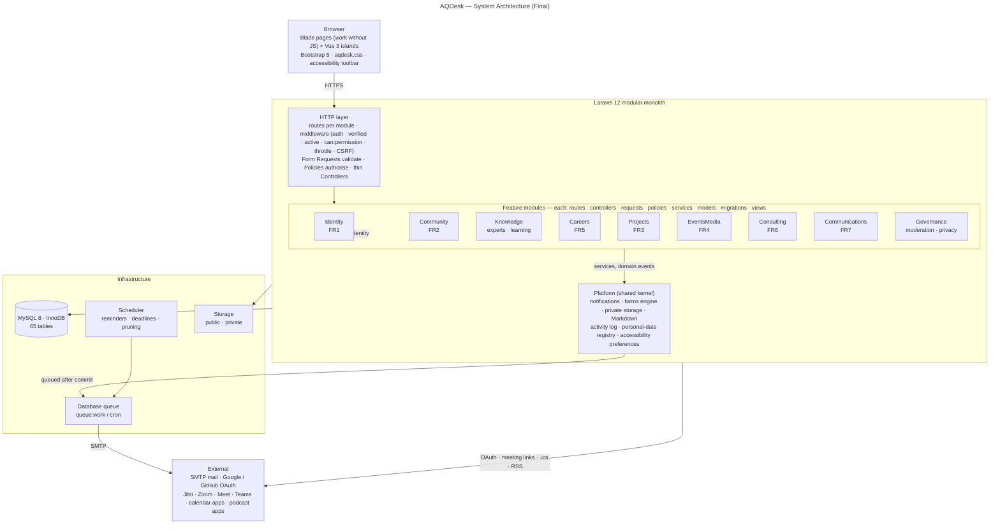

# AQDesk — Diagrams

| File | What | Phase |
|---|---|---|
| [`erd/`](erd/README.md) | **ERDs**: overview + one per module, generated from the database by `php artisan docs:schema` (65 tables) | Final |
| `10-use-case-final.mmd` | Use cases for every module and role (shown below) | Final |
| `11-architecture-final.mmd` | Modular-monolith architecture (shown below) | Final |
| `01-erd`, `02-architecture`, `03-use-case`, `04-scope`, `05-user-flow`, `06-sequence-apply`, `07-architecture-wide` | Diagrams in the prototype documentation | Prototype (kept as submitted) |

The schema SQL is `/schema/aqdesk_schema.sql`, generated with the ERDs.
After new migrations run `php artisan docs:schema` on a migrated MySQL
database to refresh both.

**Images for the report:** GitHub draws the Mermaid diagrams on this page and
in `erd/README.md`. For PNG/SVG files paste a `.mmd` file into
<https://mermaid.live> and export, or run
`npx @mermaid-js/mermaid-cli -i file.mmd -o file.svg`.

Dashed boxes in the use-case diagram are planned (roadmap 3.14–3.18).

## Use cases (final scope)

```mermaid
---
title: AQDesk — Use Case Diagram (Final Scope)
---
flowchart LR
    G(("Guest"))
    M(("Member"))
    E(("Expert"))
    A(("Administrator"))

    subgraph FR1["FR1 · Identity & access"]
        i1(["Register · verify email"])
        i2(["Sign in · Google / GitHub"])
        i3(["Reset password"])
        i4(["Profile · settings · devices"])
        i5(["Accessibility options"])
    end

    subgraph FR2["FR2 · Community Q&A"]
        c1(["Browse · search · follow tags"])
        c2(["Ask · answer · comment"])
        c3(["Vote · accept · bookmark"])
        c4(["Earn reputation & badges"])
    end

    subgraph KN["Knowledge & learning"]
        k1(["Read articles · learning paths"])
        k2(["Track path progress"])
        k3(["Apply for expert verification"])
        k4(["Write articles · curate paths"])
    end

    subgraph FR5["FR5 · Opportunities"]
        j1(["Browse jobs & opportunities"])
        j2(["Apply · track application"])
        j3(["Save · job alerts"])
        j4(["Publish · organization profile"])
        j5(["Review applicants · notes"])
    end

    subgraph FR3["FR3 · Projects"]
        p1(["Create project · invite"])
        p2(["Share versioned files"])
        p3(["Feedback threads"])
        p4(["Task board"])
    end

    subgraph FR4["FR4 · Events & podcasts"]
        e1(["Register · waitlist · calendar"])
        e2(["Join webinar"])
        e3(["Organize event · attendees"])
        e4(["Listen · read transcript"])
        e5(["Publish podcast episodes"])
    end

    subgraph FR6["FR6 · Consulting"]
        s1(["Find consultant · book session"])
        s2(["Join · cancel session"])
        s3(["Set hours & days off"])
        s4(["Manage clients · private notes"])
        s5(["Proposals"])
    end

    subgraph FR7["FR7 · Newsletter & announcements"]
        n1(["Subscribe · unsubscribe"])
        n2(["Campaigns · delivery reports"])
        n3(["Site announcements"])
    end

    subgraph PL["Forms"]
        f1(["Build form · read responses"])
        f2(["Fill in a form"])
    end

    subgraph GV["Governance & privacy"]
        g1(["Report content"])
        g2(["Download my data · delete account"])
        g3(["Moderation queue · decision log"])
        g4(["Users · roles & permissions · audit log"])
        g5(["Verify experts"])
    end

    G --> i1 & i2 & c1 & k1 & j1 & e4 & s1 & n1 & f2

    M --> i3 & i4 & i5 & c2 & c3 & c4 & k2 & k3
    M --> j2 & j3 & p1 & p2 & p3 & p4 & e1 & e2 & s2 & g1 & g2

    E --> k4 & j4 & j5 & e3 & e5 & s3 & s4 & s5 & f1

    A --> g3 & g4 & g5 & n2 & n3

    classDef actor fill:#0f172a,stroke:#0f172a,color:#fff
    classDef later fill:#eeeeee,stroke:#9e9e9e,color:#555,stroke-dasharray: 6 4
    class G,M,E,A actor
    class s5,n1,n2,n3 later
```

## Architecture (final)

