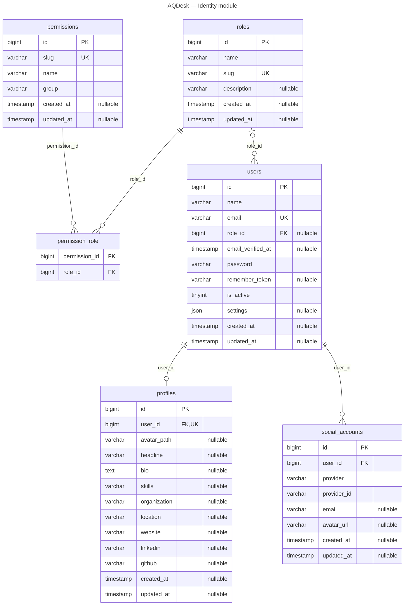
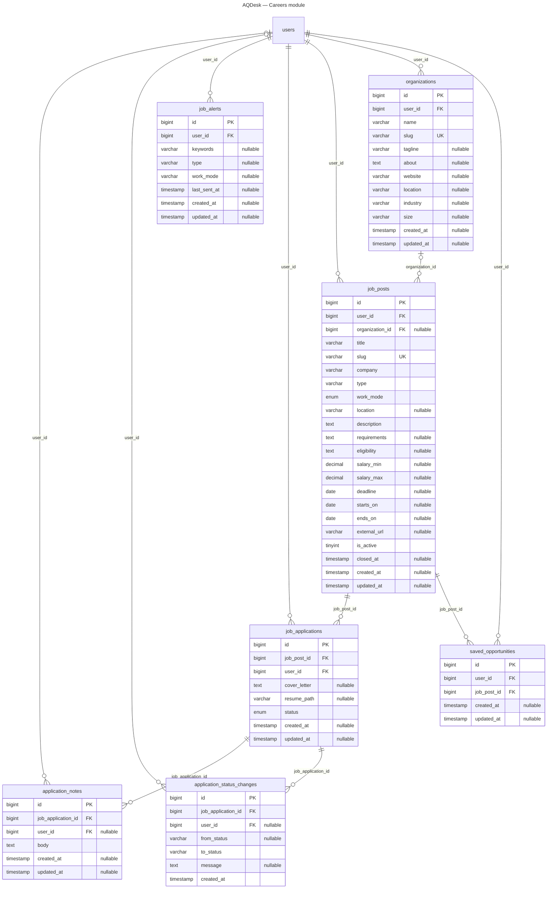
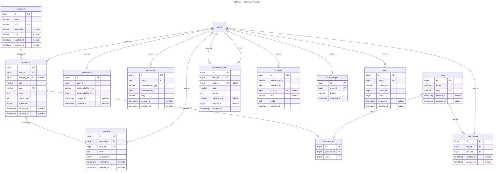
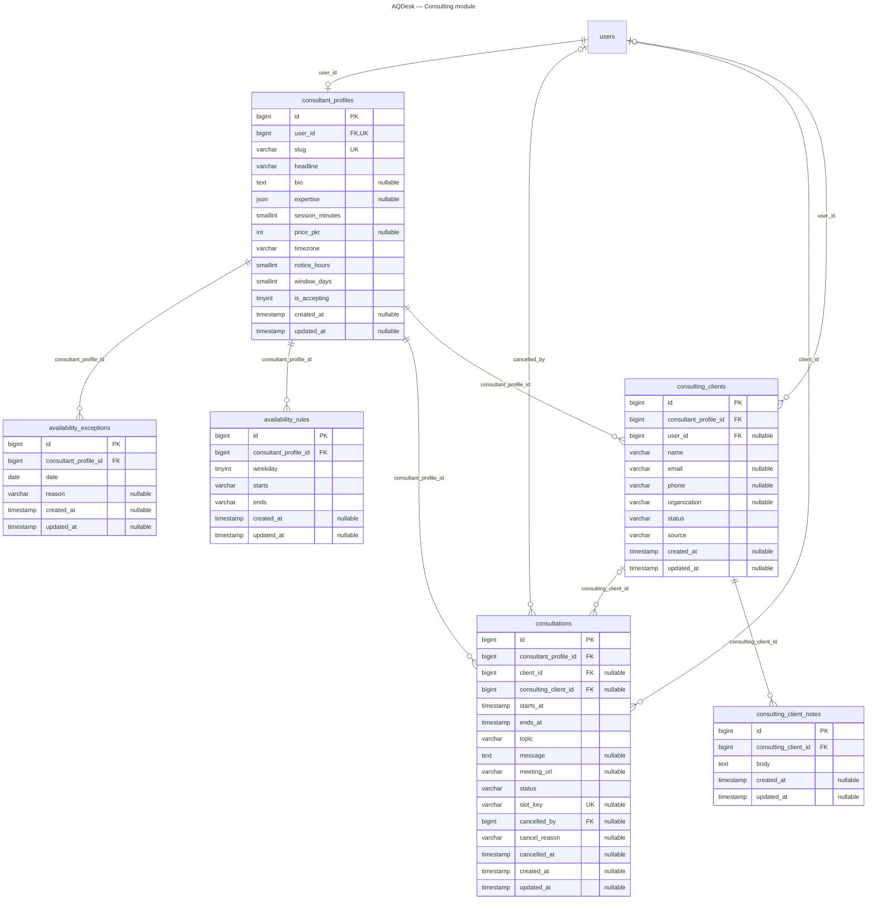
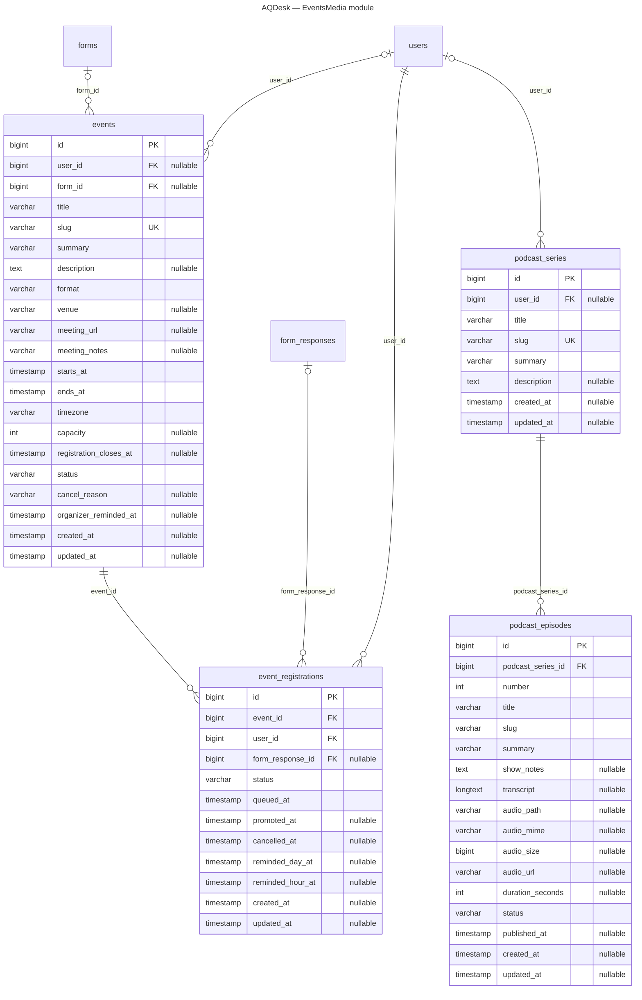
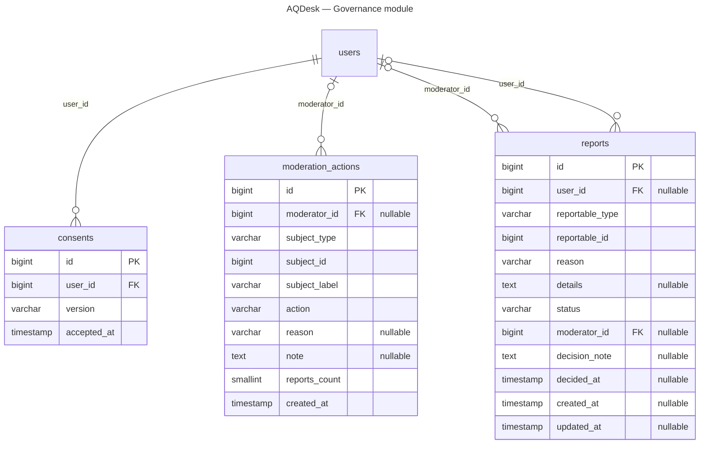
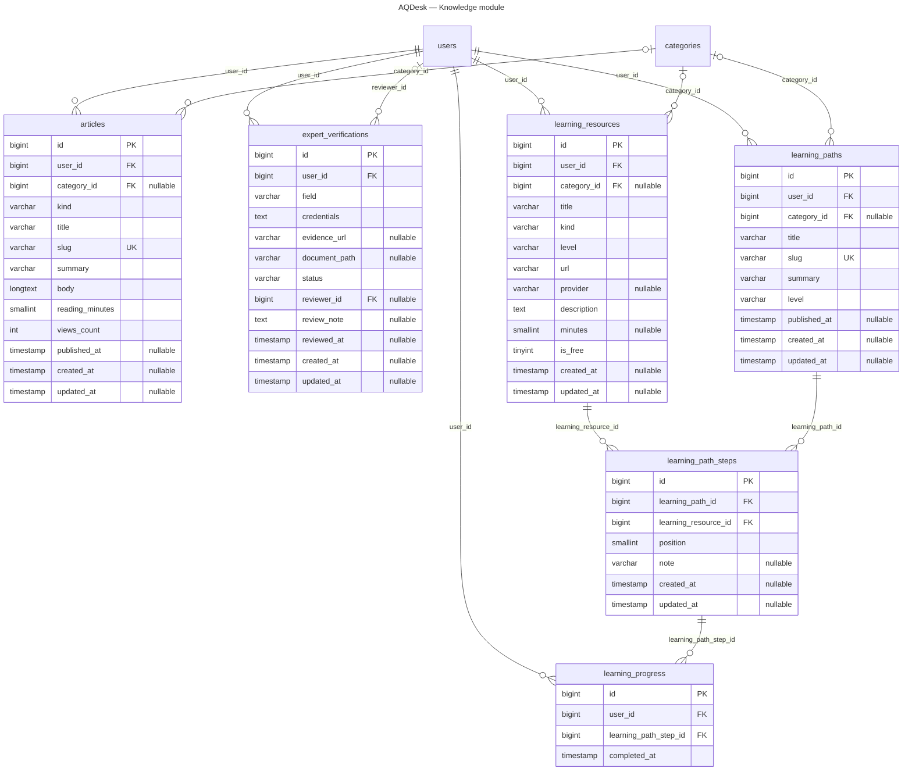
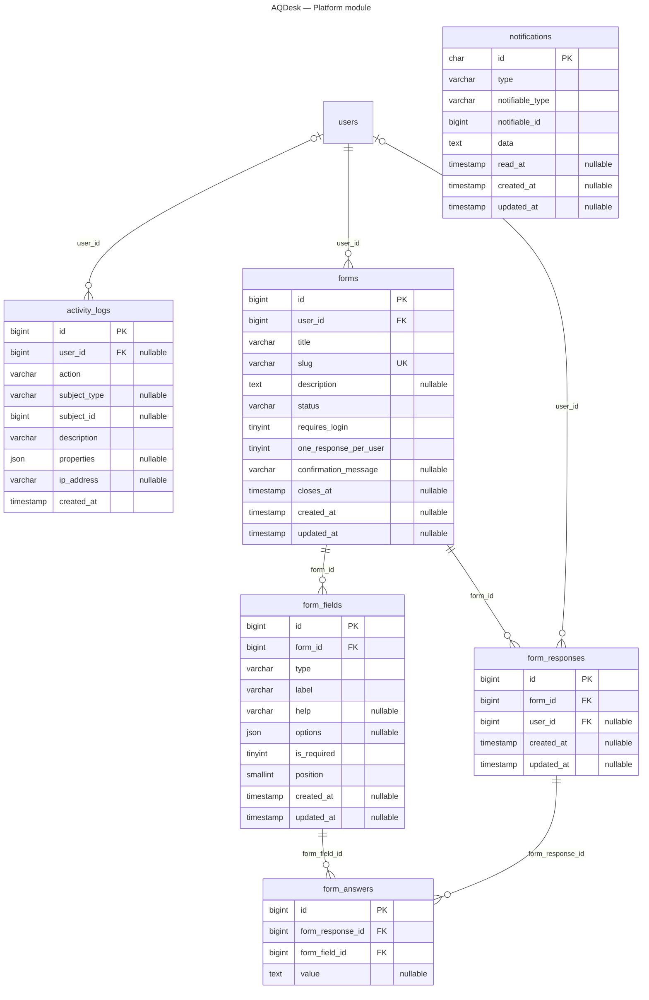
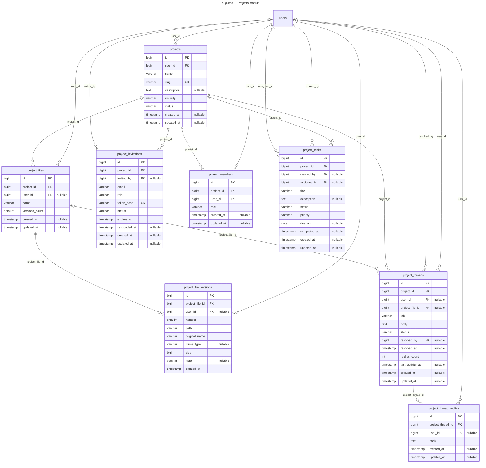

# AQDesk — Entity Relationship Diagrams

Generated by `php artisan docs:schema` from the migrated database (65 tables). GitHub renders the diagrams below; the `.mmd` files open in any Mermaid editor.

## Overview — all modules

```mermaid
---
title: AQDesk — all modules (relationships only)
---
erDiagram
    permissions ||--o{ permission_role : "permission_id"
    roles ||--o{ permission_role : "role_id"
    users ||--o| profiles : "user_id"
    users ||--o{ social_accounts : "user_id"
    roles |o--o{ users : "role_id"
    job_applications ||--o{ application_notes : "job_application_id"
    users |o--o{ application_notes : "user_id"
    job_applications ||--o{ application_status_changes : "job_application_id"
    users |o--o{ application_status_changes : "user_id"
    users ||--o{ job_alerts : "user_id"
    job_posts ||--o{ job_applications : "job_post_id"
    users ||--o{ job_applications : "user_id"
    organizations |o--o{ job_posts : "organization_id"
    users ||--o{ job_posts : "user_id"
    users ||--o{ organizations : "user_id"
    job_posts ||--o{ saved_opportunities : "job_post_id"
    users ||--o{ saved_opportunities : "user_id"
    questions ||--o{ answers : "question_id"
    users ||--o{ answers : "user_id"
    users ||--o{ bookmarks : "user_id"
    users ||--o{ comments : "user_id"
    questions ||--o{ question_tag : "question_id"
    tags ||--o{ question_tag : "tag_id"
    categories |o--o{ questions : "category_id"
    users ||--o{ questions : "user_id"
    users |o--o{ reputation_events : "actor_id"
    users ||--o{ reputation_events : "user_id"
    users |o--o{ revisions : "user_id"
    tags ||--o{ tag_follows : "tag_id"
    users ||--o{ tag_follows : "user_id"
    users ||--o{ user_badges : "user_id"
    users ||--o{ votes : "user_id"
    consultant_profiles ||--o{ availability_exceptions : "consultant_profile_id"
    consultant_profiles ||--o{ availability_rules : "consultant_profile_id"
    users ||--o| consultant_profiles : "user_id"
    users |o--o{ consultations : "cancelled_by"
    users |o--o{ consultations : "client_id"
    consultant_profiles ||--o{ consultations : "consultant_profile_id"
    consulting_clients |o--o{ consultations : "consulting_client_id"
    consulting_clients ||--o{ consulting_client_notes : "consulting_client_id"
    consultant_profiles ||--o{ consulting_clients : "consultant_profile_id"
    users |o--o{ consulting_clients : "user_id"
    events ||--o{ event_registrations : "event_id"
    form_responses |o--o{ event_registrations : "form_response_id"
    users ||--o{ event_registrations : "user_id"
    forms |o--o{ events : "form_id"
    users |o--o{ events : "user_id"
    podcast_series ||--o{ podcast_episodes : "podcast_series_id"
    users |o--o{ podcast_series : "user_id"
    users ||--o{ consents : "user_id"
    users |o--o{ moderation_actions : "moderator_id"
    users |o--o{ reports : "moderator_id"
    users |o--o{ reports : "user_id"
    categories |o--o{ articles : "category_id"
    users ||--o{ articles : "user_id"
    users |o--o{ expert_verifications : "reviewer_id"
    users ||--o{ expert_verifications : "user_id"
    learning_paths ||--o{ learning_path_steps : "learning_path_id"
    learning_resources ||--o{ learning_path_steps : "learning_resource_id"
    categories |o--o{ learning_paths : "category_id"
    users ||--o{ learning_paths : "user_id"
    learning_path_steps ||--o{ learning_progress : "learning_path_step_id"
    users ||--o{ learning_progress : "user_id"
    categories |o--o{ learning_resources : "category_id"
    users ||--o{ learning_resources : "user_id"
    users |o--o{ activity_logs : "user_id"
    form_fields ||--o{ form_answers : "form_field_id"
    form_responses ||--o{ form_answers : "form_response_id"
    forms ||--o{ form_fields : "form_id"
    forms ||--o{ form_responses : "form_id"
    users |o--o{ form_responses : "user_id"
    users ||--o{ forms : "user_id"
    project_files ||--o{ project_file_versions : "project_file_id"
    users |o--o{ project_file_versions : "user_id"
    projects ||--o{ project_files : "project_id"
    users |o--o{ project_files : "user_id"
    users |o--o{ project_invitations : "invited_by"
    projects ||--o{ project_invitations : "project_id"
    projects ||--o{ project_members : "project_id"
    users ||--o{ project_members : "user_id"
    users |o--o{ project_tasks : "assignee_id"
    users |o--o{ project_tasks : "created_by"
    projects ||--o{ project_tasks : "project_id"
    project_threads ||--o{ project_thread_replies : "project_thread_id"
    users |o--o{ project_thread_replies : "user_id"
    project_files |o--o{ project_threads : "project_file_id"
    projects ||--o{ project_threads : "project_id"
    users |o--o{ project_threads : "resolved_by"
    users |o--o{ project_threads : "user_id"
    users ||--o{ projects : "user_id"
```

## Identity module

## Careers module

## Community module

## Consulting module

## EventsMedia module

## Governance module

## Knowledge module

## Platform module

## Projects module

